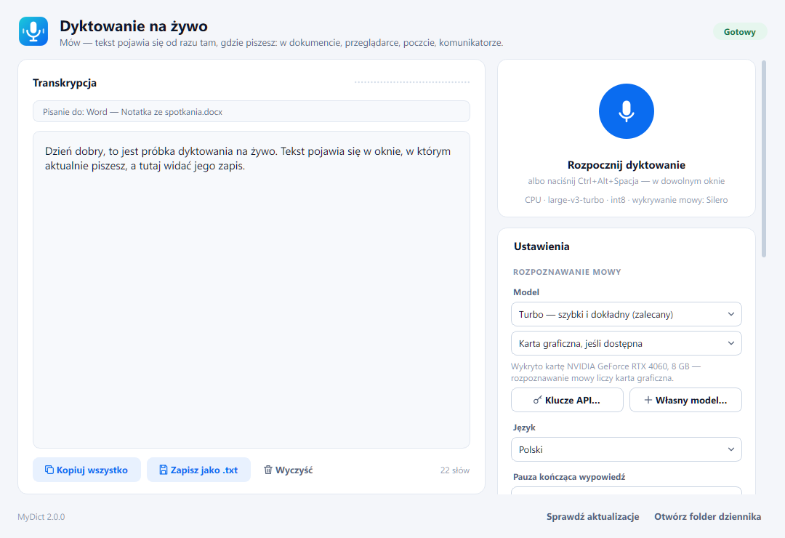

# MyDict

Dyktowanie na żywo dla Windows i macOS. Program słucha mikrofonu, pokazuje transkrypcję w trakcie
mówienia i wpisuje tekst tam, gdzie akurat piszesz — w Wordzie, przeglądarce (Gmail, Google Docs,
formularze), poczcie, komunikatorze, notatniku.



- **Rozpoznawanie na Twoim komputerze** (Whisper, bez internetu) albo **w chmurze** (Groq, OpenAI,
  ElevenLabs, Deepgram, AssemblyAI, własny serwer zgodny z OpenAI).
- **Tekst na żywo** — pływający pasek pokazuje słowa w trakcie mówienia, do okna trafiają tylko pewne.
- **Globalny skrót** — start/stop albo „przytrzymaj i mów”, w dowolnej aplikacji.
- **Automatyczne aktualizacje** z wydań GitHub.
- Motyw jasny i ciemny.

## Instalacja

Pobierz najnowsze wydanie ze strony **[Releases](../../releases/latest)**.

### Windows 10 / 11

1. Pobierz `MyDict-<wersja>-Windows-Setup.exe` i uruchom.
2. Instalator nie wymaga uprawnień administratora. Windows może pokazać ostrzeżenie SmartScreen
   („Nieznany wydawca”) — wybierz **Więcej informacji → Uruchom mimo to**.

### macOS 12 lub nowszy (Apple Silicon)

1. Pobierz `MyDict-<wersja>-macOS-arm64.dmg`, otwórz i przeciągnij aplikację do **Programy**.
2. Pierwsze uruchomienie: kliknij aplikację prawym przyciskiem → **Otwórz** (aplikacja nie jest
   jeszcze notaryzowana przez Apple). Gdy system odmówi, wejdź w **Ustawienia systemowe →
   Prywatność i ochrona** i wybierz **Otwórz mimo to**.
3. Zezwól na **Mikrofon**, a w banerze programu kliknij **Otwórz ustawienia** i włącz MyDict
   na liście **Dostępność** — bez tej zgody macOS nie pozwala wpisywać tekstu do innych aplikacji.

### Co instaluje się samo

Instalator rozpoznaje sprzęt i **w trakcie instalacji** pobiera wszystko, czego program potrzebuje,
żeby po pierwszym uruchomieniu był w pełni gotowy (wymaga internetu):

| Karta graficzna | Co się pobiera | Jak działa rozpoznawanie |
|---|---|---|
| **NVIDIA** (GeForce, RTX, GTX, Quadro) | biblioteki NVIDIA (ok. 1 GB) + model Turbo (1,6 GB) | na karcie, przez CUDA |
| NVIDIA z mniej niż 2,5 GB pamięci | biblioteki NVIDIA + model Lekki (0,5 GB) | na karcie, przez CUDA |
| **AMD / Intel — karta dedykowana** (Radeon RX, Arc) | model Turbo (0,6 GB) | na karcie, przez Vulkan |
| **AMD / Intel — karta zintegrowana** | model Lekki (0,2 GB) | na karcie, przez Vulkan |
| **Mac** (Apple Silicon) | model Turbo (0,6 GB) — przy pierwszym uruchomieniu | na karcie, przez Metal |
| brak karty albo karta bez Vulkan | model Lekki (0,5 GB) | na procesorze |

Program ma dwa silniki rozpoznawania mowy i sam wybiera właściwy: **faster-whisper** dla kart NVIDIA
(CUDA) oraz **whisper.cpp** dla kart AMD i Intel (Vulkan) i dla Maców (Metal). Wykryty sprzęt program
pokazuje w ustawieniach pod listą modeli; tam też można ręcznie przełączyć silnik albo wymusić procesor.
Gdy karta nie obsłuży przyspieszenia, program sam przechodzi na procesor. Gdy pobieranie zostanie
pominięte albo zabraknie internetu, program dokończy je przy uruchomieniu.

## Jak dyktować

- Kliknij w miejsce, gdzie ma się pojawić tekst.
- Naciśnij skrót (Windows: **Ctrl+Alt+Spacja**, macOS: **Ctrl+Option+Spacja**) albo mikrofon
  na pływającym pasku i mów.
- Pasek pokazuje tekst na bieżąco: **biały = pewny**, **szary = jeszcze się zmienia**. Do okna
  trafiają tylko słowa pewne — zwykle ok. 1 s za mową.
- Krótka pauza kończy wypowiedź: model robi dokładniejszy przebieg i domyka zdanie.
- Ten sam skrót kończy dyktowanie.

Tryb **„Przytrzymaj i mów”**: trzymasz skrót, mówisz, puszczasz. Najlepiej z klawiszem bez
modyfikatorów (F8, F9).

Przycisk klawiatury na pasku wstrzymuje wpisywanie — tekst zostaje wtedy tylko w podglądzie.


## Dyktowanie znaków i formatowania

Komendy działają automatycznie, zarówno z lokalnym Whisperem, jak i z modelami
w chmurze. Mów nazwę znaku w środku zdania. Program zamienia ją na znak przed
wyświetleniem i wpisaniem tekstu do aktywnego okna.

| Powiedz | Program wpisze |
|---|---|
| kropka, przecinek, dwukropek, średnik | `.` `,` `:` `;` |
| pytajnik / znak zapytania, wykrzyknik | `?` `!` |
| wielokropek / trzy kropki | `…` |
| myślnik / minus | `-` z odstępami pomiędzy słowami |
| pauza | `—` z odstępami |
| łącznik | `-` bez odstępów: `biało-czerwony` |
| nowa linia / nowy wiersz | przejście do kolejnego wiersza |
| nowy akapit | dwa przejścia do nowego wiersza |
| otwórz nawias / nawias otwierający | `(` |
| zamknij nawias / nawias zamykający | `)` |
| otwórz / zamknij nawias kwadratowy | `[` `]` |
| otwórz / zamknij nawias klamrowy | `{` `}` |
| otwórz / zamknij cudzysłów | `„` `”` |
| apostrof | `'` bez odstępów |
| ukośnik / ukośnik wsteczny | `/` `\` bez odstępów |
| podkreślnik, małpa / znak małpy | `_` `@` bez odstępów |
| procent, promil | `%` `‰` bez odstępu z lewej |
| plus, znak równości / równa się, gwiazdka, ampersand | `+` `=` `*` `&` z odstępami |
| hasztag / kratka | `#` przyklejony do następnego słowa |

Przykład — powiedz:

> Zakupy dwukropek nowa linia myślnik mleko nowa linia myślnik chleb

Wynik:

```text
Zakupy:
- mleko
- chleb
```

**Żeby zapisać nazwę znaku jako słowo**, powiedz przed komendą **„dosłownie”**:
„dosłownie dwukropek” daje `dwukropek`, a „dosłownie nowa linia” daje `nowa linia`.
Dotyczy to też zwykłych słów występujących na liście komend, takich jak „procent”,
„plus”, „minus”, „małpa” czy „pauza”. Inne wyrazy nie są zamieniane, np. „kropkami”.

Komendę z kilku słów wypowiadaj bez długiej pauzy w jej środku. Podczas dyktowania
na żywo program przytrzymuje możliwy początek komendy do czasu rozpoznania reszty;
nie wpisuje do innej aplikacji słowa „nowa”, żeby później je usuwać. Po pauzie lub
zatrzymaniu dyktowania niedokończona komenda pozostaje zwykłym tekstem.
Wielkość liter i brak polskich znaków w nazwie komendy nie mają znaczenia.

Program usuwa bezpośrednio po nazwie komendy znaki interpunkcyjne dopisane przez
model, np. „dwukropek.” daje jeden `:`, a „kropka.” daje jedną `.`. Zamiana działa
na tekście rozpoznanym przez model: gdy Whisper pominie lub przekręci nazwę komendy,
może ona nie zadziałać. Zwykła kropka oddziela zdania i dodaje odstęp przed następnym
słowem; ta funkcja nie służy do składania adresów e-mail ani adresów stron.

**Nowa linia i nowy akapit wysyłają klawisz Enter do aktywnej aplikacji.**
W komunikatorze Enter może wysłać wiadomość — używaj tych komend w polach, w których
Enter tworzy nowy wiersz.

Po aktualizacji źródeł uruchom ponownie program przez **Uruchom ze zrodel.bat**.
Gotowa aplikacja `.exe` wymaga nowej kompilacji; sama zmiana plików `.py` jej nie aktualizuje.

## Aktualizacje

Program raz dziennie sprawdza, czy jest nowsze wydanie (można to wyłączyć w ustawieniach albo
sprawdzić ręcznie: **Sprawdź aktualizacje** na dole okna). Po kliknięciu **Zainstaluj i uruchom
ponownie** pobiera plik, sprawdza jego sumę SHA-256, instaluje i wraca do pracy. Ustawienia, klucze
API i pobrane modele zostają bez zmian.

Na macOS, dopóki aplikacja nie jest podpisana certyfikatem Apple, po aktualizacji system może
ponownie poprosić o zgodę **Dostępność**.

## Modele w chmurze (API)

Na liście **Model** poniżej modeli lokalnych są modele w chmurze. **To opcja dodatkowa, w trakcie
testów** — przeznaczona dla osób, które mają własne konto u dostawcy:

- klucz API każdy tworzy **samodzielnie**; program nie zawiera i nie udostępnia żadnego klucza,
- darmowe plany (np. Groq) mają **niskie limity zapytań**, więc w praktyce to opcja dla planów płatnych,
- szybkość zależy od usługi i łącza i nie została jeszcze zmierzona — patrz
  [docs/plan-testow.md](docs/plan-testow.md).

- **Klucze API…** — wklejasz klucz usługi; „Sprawdź” testuje go bez wysyłania dźwięku. Klucze są
  szyfrowane kontem Windows (DPAPI), a na macOS trafiają do pęku kluczy. Klucze ze zmiennych
  środowiskowych (`OPENAI_API_KEY`, `GROQ_API_KEY`, …) i z pliku `secrets.env` w katalogu danych
  programu są używane automatycznie.
- **Własny model…** — podajesz rodzaj API, adres, nazwę modelu i klucz. Pozwala użyć nowego modelu
  albo własnego serwera zgodnego z OpenAI.

Model w chmurze dostaje **całą wypowiedź po pauzie** (plik WAV 16 kHz), więc tekst pojawia się po
pauzie, a nie słowo po słowie. Wyjątkiem jest Deepgram w trybie strumieniowym. Każda wypowiedź jest
płatna według cennika dostawcy.

### Plik `dostawcy.json`

Adresy API, lista modeli i parametry zapytań są w pliku `dostawcy.json`. Aby je zmienić, skopiuj
plik do katalogu danych programu (patrz niżej) i edytuj kopię — ma pierwszeństwo przed wersją
dołączoną do programu i przetrwa aktualizację.

* `params` — parametry dopisywane do zapytania (np. `smart_format`, `punctuate`); model może mieć własne.
* `stream: true` (Deepgram) — dźwięk płynie na bieżąco przez WebSocket, tekst pojawia się w trakcie
  mówienia, a koniec wypowiedzi wykrywa serwer.
* `streaming_params` — `interim_results` (wyniki pośrednie) i `endpointing` (ms ciszy kończące
  wypowiedź, domyślnie 200). `local_finalize_ms` (domyślnie 400) działa po stronie programu: po tylu ms
  ciszy program wysyła `Finalize`, więc tekst jest zatwierdzany od razu. `0` wyłącza.
* W trybie strumieniowym Deepgram nalicza opłatę za cały czas połączenia, także za ciszę.

## Dźwięk komputera zamiast mikrofonu (Windows)

Na liście źródeł dźwięku są pozycje **„🔊 Dźwięk komputera: …”** — program słucha wtedy tego, co gra
komputer (WASAPI loopback). Przydatne do testów na nagraniu i do transkrypcji rozmów.
„Wszystkie wyjścia (automatycznie)” bierze dźwięk z tego wyjścia, na którym akurat coś gra.

## Gdzie są dane

| | Windows | macOS |
|---|---|---|
| Dziennik, pomiary | `%LOCALAPPDATA%\MyDict` | `~/Library/Logs/MyDict` |
| Składniki, własna konfiguracja | `%LOCALAPPDATA%\MyDict` | `~/Library/Application Support/MyDict` |
| Modele Whisper | `%USERPROFILE%\.cache\huggingface` | `~/.cache/huggingface` |

Przycisk **Otwórz folder dziennika** na dole okna prowadzi wprost do dziennika `dyktowanie.log`.
Plik `ustawienia_asr.json` (np. `{"final_beam": 5}`) skopiowany do katalogu danych zmienia ustawienia
dekodera.

## Ograniczenia

- Windows nie pozwala wpisywać do programów uruchomionych **jako administrator**, jeśli
  MyDict nie działa tak samo — pasek pokaże ostrzeżenie.
- macOS: program zna nazwę aktywnej aplikacji, ale nie tytuł okna; dźwięk komputera (loopback)
  nie jest dostępny.
- Interpunkcję i wielkie litery dodaje model.

## Dla programistów

```
python -m venv .venv
.venv\Scripts\activate            # macOS: source .venv/bin/activate
pip install -r requirements-build.txt
python MyDict.py         # uruchomienie ze źródeł
python -m pytest tests            # testy
python packaging/build_whispercpp.py   # drugi silnik (wymaga CMake; Windows: Visual Studio C++ i Vulkan SDK)
python packaging/build.py         # aplikacja + instalator dla bieżącego systemu
```

| Plik | Rola |
|---|---|
| `dyktowanie_core.py` | strumieniowanie: wykrywanie mowy (Silero VAD), LocalAgreement, filtr halucynacji |
| `dyktowanie_asr.py` | model faster-whisper, mikrofon, dźwięk komputera, wątek roboczy |
| `dyktowanie_api.py`, `dyktowanie_stream.py` | modele w chmurze (HTTP i WebSocket), klucze |
| `dyktowanie_windows.py`, `dyktowanie_macos.py` | aktywne okno, wpisywanie, globalny skrót; wybór w `dyktowanie_platforma.py` |
| `dyktowanie_ui.py`, `dyktowanie_api_ui.py`, `dyktowanie_motyw.py` | interfejs i motywy |
| `dyktowanie_aktualizacje.py`, `dyktowanie_pobieranie.py` | aktualizacje z GitHuba, pobieranie z kontrolą sumy |
| `dyktowanie_whispercpp.py` | drugi silnik: whisper.cpp jako lokalny proces (Vulkan / Metal) |
| `dyktowanie_sprzet.py`, `dyktowanie_przygotowanie.py` | rozpoznanie karty, dobór silnika i modelu, pobieranie składników przy instalacji |
| `dyktowanie_gpu_pakiet.py` | biblioteki NVIDIA pobierane przy instalacji |
| `dyktowanie_app.py` | wersja, nazwy, katalogi |
| `packaging/` | PyInstaller, Inno Setup, skrypty wydań |

- Jak wydać nową wersję: [docs/wydawanie.md](docs/wydawanie.md).
- Pomiar opóźnień (`[LAT #N]`, `latencja.csv`): [docs/pomiar-latencji.md](docs/pomiar-latencji.md).
- Pomysły sprawdzone i odrzucone (nie powtarzać): [docs/eksperymenty.md](docs/eksperymenty.md).
